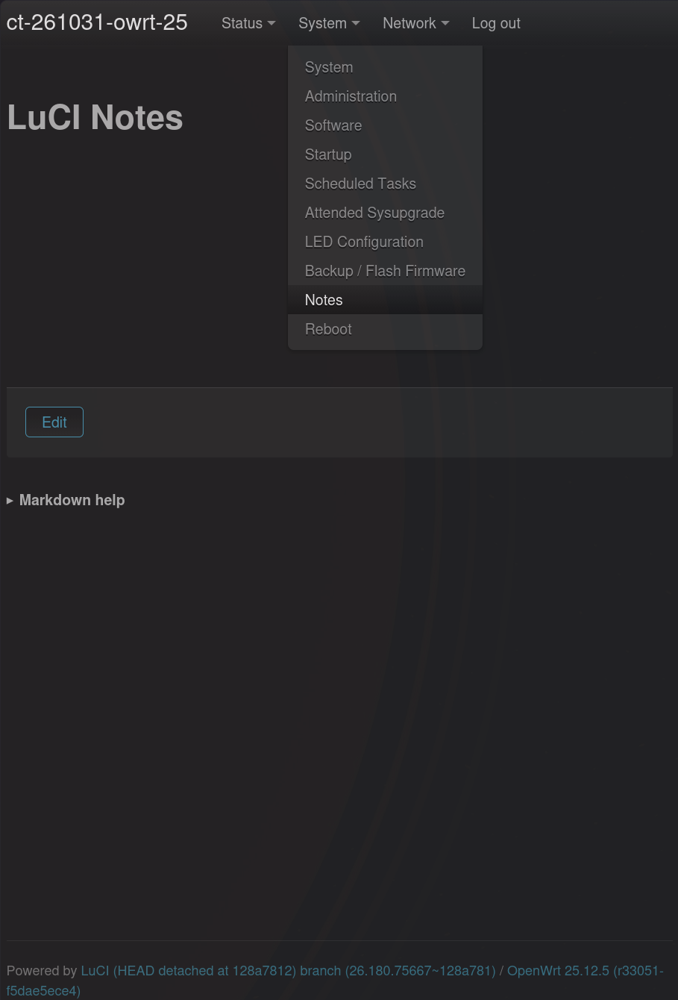
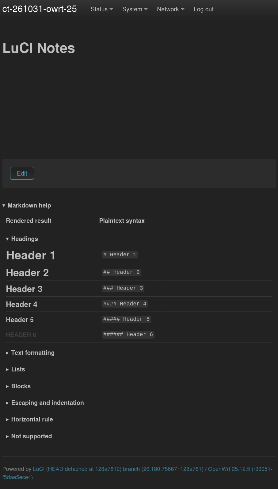
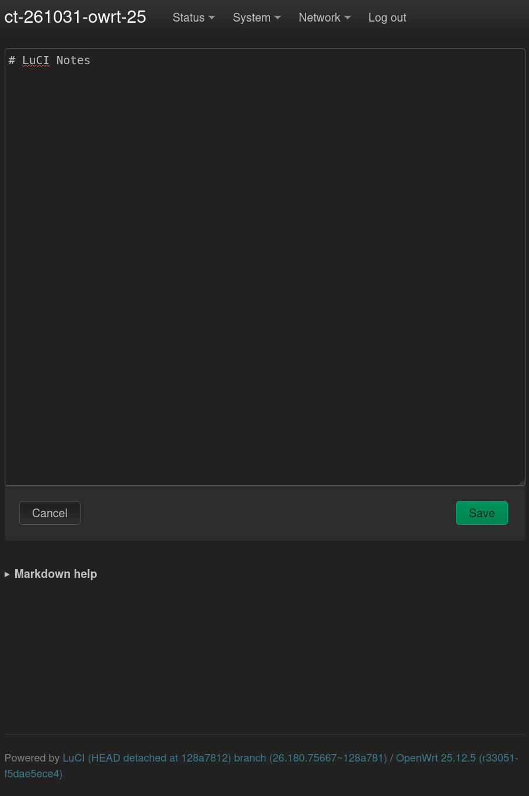

# LuCI Notes

A lightweight Markdown notes application for LuCI, storing content in a single plain-text file on the router. 

## Description

This app adds a Notes page to LuCI (System -> Notes) backed by `/etc/notes.md`. It uses:

- An rpcd ucode backend (notes ubus object) for reading and writing the file
- A JavaScript LuCI view for the editor/viewer UI
- A small custom Markdown-to-HTML renderer without external dependencies

The application provides a plain-text Markdown editor with built-in syntax help. Notes are rendered as formatted Markdown outside edit mode.

LuCI Notes uses LuCI's standard PO/Weblate translation workflow for localized interface text and Markdown help.

For standalone releases, language-specific translations may be distributed through `luci-i18n-notes-*` packages.

## Compatibility

Both .ipk and .apk packages are built with `LUCI_PKGARCH:=all` and should run on any OpenWrt-supported architecture.

Tested and working with both OpenWrt package formats:

- .ipk - tested on x86_64, OpenWrt v24.10.8
- .apk - tested on x86_64, OpenWrt v25.12.5

## Installation

Download the appropriate package for your OpenWrt version from the [latest release](https://github.com/vikzil/luci-app-notes/releases/latest).

If available, install the corresponding `luci-i18n-notes-*` language package to use a translated interface and Markdown help.

There is currently no custom package repository, so these packages are not signed by a trusted repository.

### apk (OpenWrt v25.x and later)

Install the application package with --allow-untrusted:

`apk add --allow-untrusted /path/to/luci-app-notes-*.apk`

If using a language package, install it the same way. For example:

`apk add --allow-untrusted /path/to/luci-i18n-notes-*.apk`

### ipk (OpenWrt v24.x and earlier)

Install the application package:

`opkg install /path/to/luci-app-notes_*.ipk`

If using a language package, install it as well. For example:

`opkg install /path/to/luci-i18n-notes-*.ipk`

After installing, log out of LuCI and log back in for the Notes menu entry to appear under **System → Notes**.

The file `/etc/notes.md` is a conffile, so it survives package upgrades and will not be overwritten if you have already edited it. 

Uninstalling the package does not automatically delete `/etc/notes.md`. Remove it manually if you want a clean slate.

## Build Notes

- Place the package under `feeds/luci/applications/luci-app-notes/`.
- Run `make menuconfig` and make sure luci-app-notes is selected under:
  `LuCI ---> 3. Applications --->`
- To build support for additional languages, select the desired languages under:
  `LuCI ---> 2. Modules ---> Translations --->`
- Build just this package:
  `make package/feeds/luci/luci-app-notes/{clean,compile} V=s`
- Verify that the package has been built:
```
find bin/packages -iname '*luci-app-notes*'
```

## Markdown Scope & Usage

LuCI Notes supports a small subset of Markdown.

Built-in expandable Markdown help provides examples of supported formatting, showing the rendered result alongside the corresponding plaintext syntax.

The help also includes a **Not supported** section describing Markdown features and functionality that are not available.

## Screenshots

**Notes page and LuCI menu integration**


**Rendered Markdown, Edit button and Markdown help**


**Markdown editor with Cancel and Save buttons**


